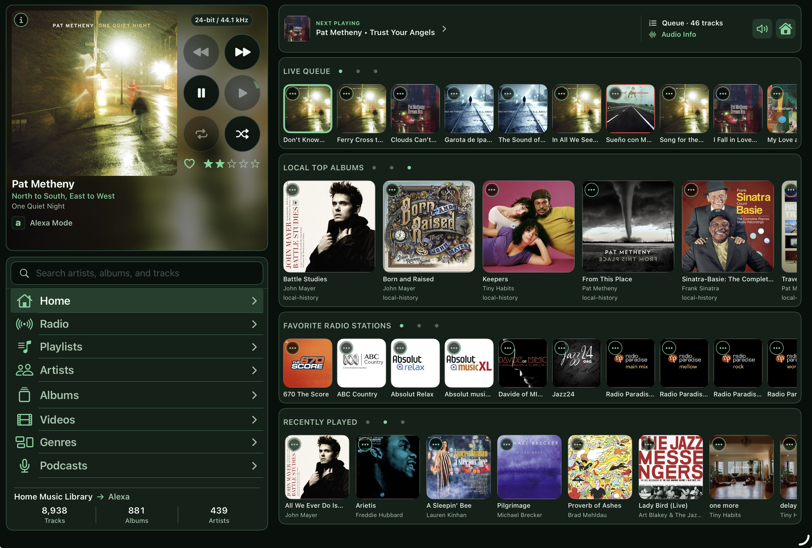
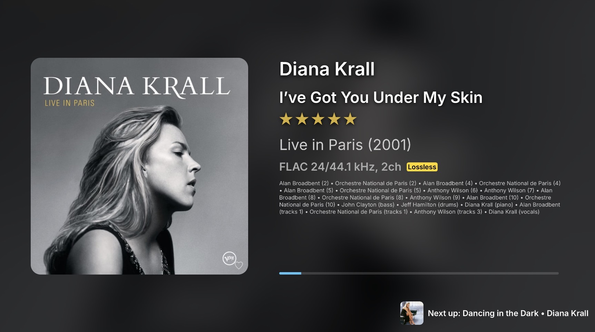
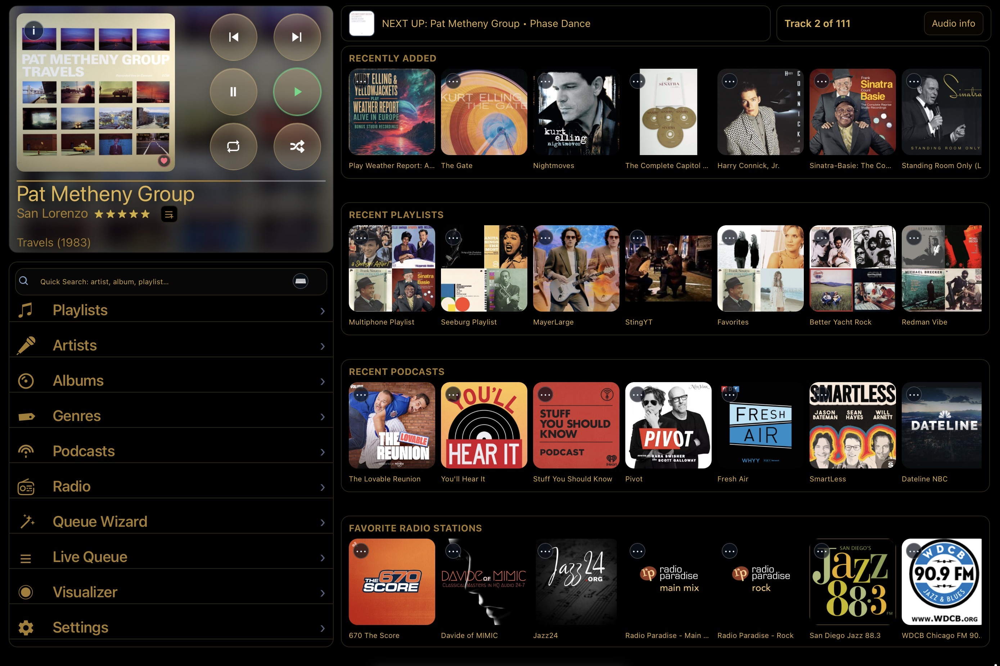

# Sonuvi

**Your music. Your libraries. Your listening experience.**

*Sonuvi chooses the music. You choose the renderer.*

Sonuvi is a music platform that began as an enhancement layer for [moOde audio](https://moodeaudio.org/) and MPD. It combines richer playback controls, library tools, metadata, intelligent queues, displays, and integrations with web and native Apple-device experiences.

moOde remains a core, dependable playback engine for Sonuvi. The wider goal is to make the listening experience less dependent on any one music library, controller, or output device.


<sub>Sonuvi for iOS</sub>


<sub>Sonuvi Now-Playing display</sub>


<sub>Sonuvi web-app controller.</sub>

## What Sonuvi provides

### Music libraries and listening tools

- moOde/MPD library browsing, queue control, playlists, favorites, ratings, and library diagnostics.
- Queue Wizard and Last.fm-assisted Vibe Radio for building listening sessions.
- Listening history, play counts, and scrobbling for supported playback paths.
- Internet radio, podcasts, YouTube audio, and supported webstream playback.
- Device-local playback/import surfaces in the native iOS app, including music on external storage; the approved device-owned canonical catalog and provider-merge model remain future architecture.
- Apple Music integrations and sharing features in the native app.
- Qobuz Connect observation, playback controls, and saved-queue capture and restoration through the Sonuvi Server and an enhanced PiBuZ receiver.

Sources differ in authentication, catalog access, and playback support; not every source can play through every renderer.

### Controllers, displays, and apps

- Responsive web dashboard and phone, tablet, and computer controllers.
- Now Playing, Player, Peppy, Visualizer, and Kiosk display experiences.
- Installable browser-based controller interfaces.
- Native iPhone and iPad application with supported server-connected and standalone workflows.
- Themes, layouts, artwork and metadata views, customization, and diagnostics.

The native iOS application lives in a separate repository. CarPlay integration is a development goal, subject to Apple's entitlements and distribution requirements; it is not presented here as a generally available feature.

## Choose your music. Choose where it plays.

Sonuvi separates **music selection** from **playback destination** wherever the underlying source and transport allow it.

| Playback path | Role |
| --- | --- |
| **moOde / MPD** | Plays the local and network music library; Sonuvi adds controls, displays, and integrations. |
| **Qobuz Connect / PiBuZ** | Plays Qobuz streams on the receiver while Sonuvi observes and controls the active session. |
| **Listen on Device** | Plays supported audio sources directly on a compatible device. |
| **UPnP / OpenHome** | Network-renderer discovery and playback capabilities under active development; support varies by renderer and source. |

**Sonuvi chooses the music. You choose the renderer.** This is the product direction, not a claim that every source-to-renderer combination already works.

## Qobuz Connect

Sonuvi Server integrates with a Sonuvi-enhanced [PiBuZ receiver](https://github.com/teacherguy2020/sonuvi-pibuz) to provide:

- Live Qobuz Connect status, track metadata, queue, and playback position.
- Play/pause, next/previous, seek, and queue-occurrence navigation.
- Capture, browse, rename, and delete saved Qobuz Connect queues.
- Restore a saved queue with ordered tracks, duplicate occurrences, and a selected start position.
- Restricted Server-to-PiBuZ bridge operations, operation-status readback, and SSE connection-lifecycle improvements.

The saved-queue workflow has been tested end to end on the development receiver, including native iPad playback. Exact receiver and deployment requirements are documented separately.

**Qobuz Connect is not an independently authenticated Qobuz library.** Browsing personal Qobuz favorites, playlists, and catalog search as a native Sonuvi source remains under investigation and depends on appropriate API access and authorization.

## Architecture

The recommended moOde setup runs Sonuvi Server on a separate LAN host:

```text
Web / PWA / display clients             Native iPhone / iPad
              |                                  |
              +-------------+--------------------+
                            |
                  Sonuvi UI :8101
                  Sonuvi API :3101
                            |
              +-------------+-------------+
              |                           |
         moOde / MPD                Enhanced PiBuZ
     music playback, UPnP       Qobuz Connect playback
```

The Sonuvi API host handles state normalization, web routes, metadata, queue tools, integrations, and UI delivery. **MPD/moOde remains the authority for MPD playback**; Qobuz Connect and device-local players have their own playback state and control boundaries.

The native iOS app also supports selected device-local workflows without an active Sonuvi Server. Supported sources and playback destinations vary by configuration.

## Quick start: Sonuvi Server with moOde

1. Have a working moOde/MPD player reachable on your LAN.
2. Prepare the application host with Node.js, npm, `mpc`, and the process-management dependencies specified by the installer.
3. Install Sonuvi Server:

   ```sh
   curl -fsSL https://raw.githubusercontent.com/teacherguy2020/now-playing/main/scripts/install.sh | bash -s -- --ref main
   ```

4. Open `config.html` and configure moOde/MPD connectivity, paths, SSH access, and a strong `trackKey`.
5. Run **Check SSH + Paths**, save the configuration, and verify `/now-playing` and a controller page.

For complete prerequisites, first-run steps, and troubleshooting, see [Getting Started](./docs/wiki-source/getting-started.md).

> **Repository-path note:** The installer URL retains the historical `now-playing` repository path. Verify that this remains the canonical installation location before changing it purely for branding.

## moOde display integration

For moOde's local display target, current supported configurations use the LAN proxy URL without an explicit `:8101` port:

```text
http://<sonuvi-host>/display.html?kiosk=1
```

The display guides cover Peppy, Player, and Visualizer setup; display URLs; blanking and wake behavior; and upgrade rollback:

- [Displays](./docs/wiki-source/displays.md)
- [Display enhancement flow](./docs/wiki-source/display-enhancement-peppy-player-flow.md)
- [moOde upgrade runbook](./docs/runbooks/22-moode-upgrade-runbook.md)

## Integrations

Sonuvi bridges software playback with smart-home and physical music systems:

- **Alexa / Homebridge / Matter** — voice control and supported automation integrations.
- **Last.fm** — listening-history scrobbling and music-discovery enrichment.
- **Seeburg wallbox** — Pico-based physical selection interface using Sonuvi's integration API.
- **Shyvers Multiphone / Mabel** — telephone-inspired music selection and operator integration maintained in a separate project.
- **Mills Throne of Music** — physical jukebox observation, display, and control integration.

See [Integrations](./docs/wiki-source/integrations.md) for ownership and control boundaries.

## Where Sonuvi is headed

Active development and investigation include:

- First-class library providers for streaming, local, and cloud music.
- Independent Qobuz favorites, playlists, and catalog browsing, subject to Qobuz API authorization.
- Unified music identities with multiple provider-specific source locations.
- Mixed-source shelves and playlists, with source-aware playback resolution.
- Broader UPnP/OpenHome renderer support.
- Device-local and cloud-synchronized personal music metadata.
- Expanded native iOS and CarPlay experiences.

These are **development directions**, not claims of general availability.

## Documentation

The editable documentation source is [`docs/wiki-source/`](./docs/wiki-source/README.md). `docs/wiki-site/` and the GitHub Wiki are generated/published outputs and should not be edited directly.

- [Getting Started](./docs/wiki-source/getting-started.md)
- [Using Sonuvi](./docs/wiki-source/using-now-playing.md)
- [Displays](./docs/wiki-source/displays.md)
- [Integrations](./docs/wiki-source/integrations.md)
- [Configuration and Administration](./docs/wiki-source/configuration-and-administration.md)
- [Developer Reference](./docs/wiki-source/developer-reference.md)
- [Troubleshooting and Technical Notes](./docs/wiki-source/troubleshooting-and-technical-notes.md)

## Related projects

- [Sonuvi-enhanced PiBuZ](https://github.com/teacherguy2020/sonuvi-pibuz)
- [Seeburg Now Playing Pico](https://github.com/teacherguy2020/seeburg-nowplaying-pico)
- [Shyvers Multiphone / Mabel](https://github.com/teacherguy2020/shyvers-multiphone-mabel)

The native Sonuvi iOS application is maintained separately.

## Licensing

Sonuvi Server is released under the [Unlicense](./LICENSE), subject to the third-party notices in [THIRD_PARTY_LICENSES.md](./THIRD_PARTY_LICENSES.md).

`integrations/moode/aplmeta.py` remains GPL-3.0-or-later under its file header. Other related projects and third-party services retain their respective licenses and terms.

---

*Built for people who love their music and want more control over how they experience it.*
